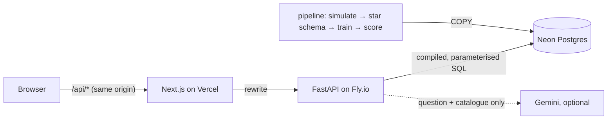

# Arunika Workforce Insights

**HR analytics on one set of metric definitions: a dashboard, plain-language questions
compiled to parameterised SQL, an attrition-risk model with reasons and a bias audit, a
monthly Excel report with live formulas, and a pseudonymous star-schema extract with DAX
measures for Power BI.**

Built for Arunika Life, a fictional Indonesian life insurer with about 740 employees across
Jakarta and four branches. Three years of workforce history come from a month-by-month
simulation whose causes of attrition are planted and documented, so every result can be
checked against the truth. All people and figures are synthetic.

| | |
|---|---|
| **Live app** | <https://arunika-workforce.vercel.app> |
| **API** | <https://arunika-workforce-api.fly.dev/health> |
| **Demo accounts** | HR analytics admin, HR business partner (four departments), leader (aggregates only). One click each on the sign-in page; password `arunika-demo` |

The API scales to zero, so the first request after a quiet period takes a few seconds.

---

## Why this exists

Three things go wrong with HR numbers in most companies:

- **"Turnover" means something different in every deck.** One team counts all exits,
  another only resignations. Some divide by the opening headcount, some by the average.
  This project defines each metric once and makes every screen, every answer and every
  export use that definition.
- **Self-service questions turn into ad-hoc SQL, or someone waits for an analyst.** Here a
  question becomes a structured query spec. The spec is checked against the catalogue, and
  the server compiles it. No language model writes SQL or sees an employee record.
- **Small groups give people away.** "Resignations in Legal, women, last quarter" can
  identify one person. Any figure resting on fewer than five people is withheld. So is any
  cell that could be recovered from a total.

## What it does

**A semantic layer** ([metrics.py](api/app/metrics.py)) defines 15 metrics, each with a
plain definition, a formula and an SQL fragment. They cover:

- headcount, hires, exits and resignations;
- turnover and voluntary turnover, annualised;
- first-year exit share, promotions, promotion rate and transfers;
- average tenure, women's share, fixed-term (PKWT) share, compa-ratio and overtime.

Any of them can be broken down by 11 dimensions: department, division, office, grade,
gender, age band, tenure band, contract type, month, quarter and year.

- **Stock and flow metrics are handled differently.** Stocks, such as headcount or a share,
  are read at the end of the period, or at the end of each month, quarter or year in a
  trend. Flows are counted across the period.
- **Rates are annualised** as `12 × events / sum of month-end headcounts`, so a quarter and a
  year compare.
- **Values are always bound as parameters.** Every fragment comes from the whitelist.
- **HR business partners are scoped.** Their departments are added to every query on the
  server, and asking for another department is refused.

**Small-cell suppression.** Any value resting on fewer than five people is withheld. For
additive metrics in a breakdown, a slice with a single hidden cell would give that cell
away through the total. In that case the smallest visible cell in the slice is hidden too,
across rows and columns, until no slice has a lone hidden cell
([tests](api/tests/test_metrics.py)).

**Ask** ([ask.py](api/app/ask.py)) turns a question in English or simple Indonesian into a
spec: one metric, up to two breakdowns, filters, a period, an order and a limit.

- **Two parsers.** Gemini handles it when a key is configured. Its response schema is
  constrained to the catalogue's metric, dimension and value codes, and it never sees
  data. Otherwise, or when the call fails, a rules parser takes over.
- **Same checks either way.** The spec goes through the same validation as a hand-built
  query, then the answer shows "Interpreted as …" and the compiled SQL with its parameters.
- **Refusals.** Questions about named individuals, forecasts and "why" are refused, each with
  a pointer to where that information does live.
- **Logging.** Every question is logged with the parser used and the outcome.

**Attrition risk** ([model.py](api/pipeline/model.py)):

- **The model.** LightGBM predicts a voluntary exit in the next six months from monthly
  snapshots, using a time-ordered train/validation/test split.
- **Calibration and ranking.** Probabilities use Platt calibration. Ranking uses the raw
  score.
- **Explanations.** Each person's three biggest risk-raising factors come from TreeSHAP
  contributions (`pred_contrib`), translated into sentences an HRBP can act on.
- **Bias audit.** Gender and age are not features. They are used only in the audit.
- **Who sees what.** HR admins see individual scores for everyone, and HRBPs for their own
  departments. Leaders get aggregates only, so a score never reaches the person deciding a
  rating or a promotion.

**Retention** shows each hire quarter's share still employed 3 to 24 months after starting.
A checkpoint a cohort has not reached yet is left empty, not zero.

**Exports** ([exports.py](api/app/exports.py)):

- **Monthly report (.xlsx).**
  - A summary against last month and the same month last year, with the change columns as
    formulas.
  - A monthly trend whose trailing-12-month voluntary turnover is a live
    `12*SUM()/SUM()` formula, with native line charts.
  - A department table with data bars and a bar chart, and the definitions.
  - Scoped and suppressed exactly like the screens.
- **Power BI extract (.zip, HR admins only).**
  - Star-schema CSVs and [measures.dax](api/app/powerbi/measures.dax), which restates the
    semantic layer in DAX, including `(published)` measures that apply the five-person rule.
  - A [setup guide](api/app/powerbi/README.md).
  - Pseudonymous: employee numbers only, with no names, birth dates, salaries or individual
    scores.

## Results

### Ask parser

The 45 evaluation questions in [ask_eval.jsonl](api/data/ask_eval.jsonl) are scored by
[evaluate_ask.py](api/scripts/evaluate_ask.py). A question counts as correct only if
everything matches: metric, breakdowns, filters, period, order and limit. For questions that
should be refused, it counts only if the parser refuses.

| Rules parser | Correct |
|---|---|
| Development set (30 questions) | 30 / 30 |
| Held-out set (15 questions) | 15 / 15 |

How much this proves:

- **The held-out questions were committed before the parser existed** (see the history). The
  parser was not tuned on them.
- **The same person wrote both sets and the parser**, so this shows the parser covers the
  phrasings it was designed for. It is not an independent benchmark.
- **Testing outside both sets found gaps that were then fixed:** a second breakdown joined
  by "and", and the singular "exit".
- **The Gemini parser has not been scored yet**, because no key was configured during
  development. Run `python -m scripts.evaluate_ask --llm` with `GEMINI_API_KEY` set.

### Attrition model

These figures are on the test months (November 2025 to April 2026, 4,448 employee-months,
each with a known six-month outcome). The full report is the
[model card](docs/model-card.md), written by the pipeline from the run.

| | Model | Ceiling | Random |
|---|---|---|---|
| ROC-AUC | 0.619 | 0.641 | 0.5 |
| PR-AUC | 0.099 | 0.132 | 0.074 |
| Leavers caught by the top 10%, one month scored | 19% (lift 1.92×) | 19% | 10% |

The **ceiling** ranks the same rows by the formula that generated the data, which no real
HR team would have, minus each person's unobserved propensity to leave. What the comparison
shows:

- **Ranking.** The model covers 84% of the distance from random to the ceiling on ROC-AUC,
  and 43% on PR-AUC.
- **The top 10%.** When one month is scored and HR looks at the top 10%, the model catches
  as many eventual leavers as the true formula would.
- **The low absolute numbers are the noise in who decides to resign, not a modelling gap.**
  The simulation was not tuned to make the model look good.

Two findings changed the pipeline:

- **Isotonic calibration was replaced by Platt scaling.** With about 250 leavers in the
  validation months, isotonic regression overfit. Brier and log loss got worse on test, the
  bottom decile was predicted at 0%, and its step function gave dozens of people the same
  probability. That made the high/elevated cut among them arbitrary. Ranking now uses the
  raw score, and Platt improves the Brier score from 0.0691 to 0.0688.
- **The probabilities are reported as running low.** They average 6.0% on the test months
  against 7.4% observed, because the validation months had a lower resignation rate (5.8%).
  The ranking is unaffected. The model card says to recalibrate on recent months before
  reading the probabilities as levels.

Planted drivers and bias:

- **Drivers.** Four of the six planted drivers that are observable as features rank in the
  top six by mean absolute SHAP: time since promotion, overtime, pay against the grade
  midpoint, and tenure. That shows the pipeline works. It says nothing about what drives
  attrition in a real workforce.
- **The audit flags a gap to investigate.** Of the people who resigned, 20% of women and 8%
  of men had been flagged.

### Retention

27% of hires leave within their first year, and first-year exits make up 24% of all exits
over the last 12 months. Both are properties of the simulation's parameters (a 1.6×
first-year hazard), and the app recovers them from the data.

## Architecture



- **Offline pipeline, light API.** pandas, LightGBM and scikit-learn run in the pipeline,
  locally or in a manual GitHub Actions workflow. They write the warehouse and the scores.
  The API image has none of them and runs in 256 MB.
- **Star schema.** `fact_headcount_monthly` has one row per employee per month, with that
  month's attributes and movement flags. Around it sit `fact_movement`,
  `fact_attrition_score`, a type-2 `dim_employee`, and department, office, grade and month
  dimensions ([warehouse.py](api/pipeline/warehouse.py)).
- **A warm-up is excluded.** The simulation starts with an existing workforce, so its first
  two months have exits but no backfill hires yet. Analysis starts after them, in the app,
  the workbook and the Power BI extract alike.

## Running it locally

Requires Python 3.12, Node 22+ and PostgreSQL 15+ (a free Neon branch works).

```bash
cd api
python -m venv .venv && . .venv/Scripts/activate   # or bin/activate
pip install -e ".[pipeline,dev]"
cp .env.example .env              # set DATABASE_URL (direct, not pooled) and JWT_SECRET
python -m pipeline.build          # simulate, load, train, score; writes docs/*.md (under a minute)
python -m scripts.evaluate_ask    # parser accuracy
TEST_DATABASE_URL=$DATABASE_URL pytest   # 81 tests
uvicorn app.main:app --port 8003
```

```bash
cd web
npm install
npm run dev                       # http://localhost:3000, proxies /api to :8003
```

## Design decisions and trade-offs

- **The language model chooses from a menu; it does not write SQL.** That limits Ask to what
  the catalogue can express: no joins to new tables, no arbitrary calculations. In
  exchange, an answer can never read a table it should not or skip the scoping and
  suppression rules.
- **Suppression is a disclosure rule, not differential privacy.** Complementary suppression
  covers totals within one answer. A determined user combining many different queries
  could still narrow things down. Real deployments add query auditing (the Ask log is a
  start) or noise.
- **Monthly snapshots, not event-level history.** This is simple, fast, and what most HR
  reporting needs. Movements within a month collapse to month-end attributes.
- **Scores are relative.** High means the top 10% of the month scored. That is stable for
  deciding whom to talk to first, but it is not a probability to act on in itself.
- **The Power BI extract is pseudonymous rather than anonymous.** Employee numbers allow
  joins back to an HRIS, which is why the extract is admin-only.

## Limitations

- The data is simulated with a known, simple structure. Real resignations have causes no HRIS
  records.
- The Gemini path is implemented and unit-tested with a mocked response. It has not been
  evaluated against the question set (see above).
- The dashboard issues its queries one after another, about 1.3 s on a warm machine. That
  is fine at this size; a busier deployment would cache per month and scope.
- Demo accounts share a password, and anyone can sign in. The data is synthetic.

## Project layout

```
api/
  pipeline/      simulate.py, warehouse.py, model.py, build.py (offline)
  app/           metrics.py (semantic layer), ask.py, exports.py, auth.py, routes/
  app/powerbi/   measures.dax and the extract guide
  data/          ask_eval.jsonl
  scripts/       evaluate_ask.py
  tests/         compiler, suppression, parsers, HTTP layer
web/             Next.js app: overview, Ask, Explore, retention, risk, model card, exports
docs/            model-card.md and simulation.md, both written by the pipeline
```
